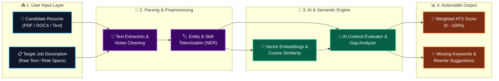
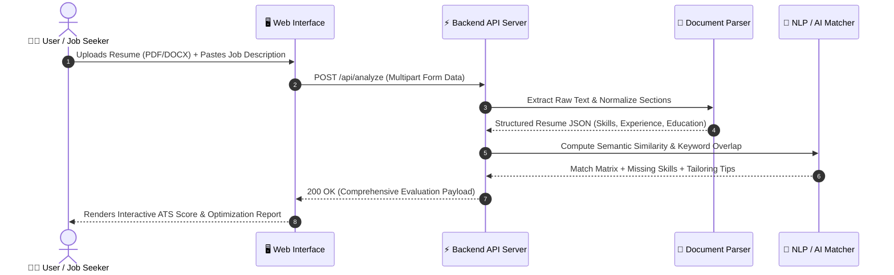
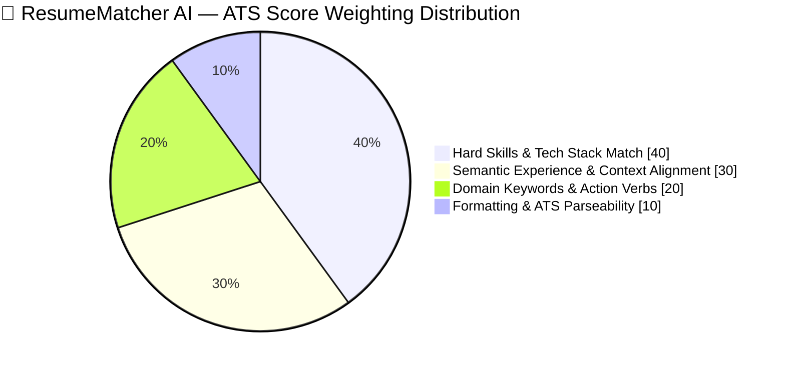

<div align="center">

<!-- ANIMATED AI WAVE HEADER BANNER -->


<!-- ANIMATED TYPING SUBTITLE -->
<a href="https://github.com/Adamnazeri/resumematcheraiproject">
  
</a>

<br />

<!-- DYNAMIC GITHUB REPO BADGES -->


<br />

<!-- MODERN SKILL ICONS SHOWCASE -->
<a href="https://skillicons.dev">
  
</a>

<br /><br />

<!-- INTERACTIVE NAVIGATION PILLS -->
<kbd> <a href="#-the-problem-vs-our-solution">🎯 Why This Matters</a> </kbd>
<kbd> <a href="#-live-ai-analysis-preview">🖥️ Output Preview</a> </kbd>
<kbd> <a href="#-ai-pipeline--architecture">🏗️ AI Architecture</a> </kbd>
<kbd> <a href="#-ats-scoring-methodology">📊 Scoring Math</a> </kbd>
<kbd> <a href="#-quick-start--installation">🚀 Quick Start</a> </kbd>
<kbd> <a href="#-api-specification">📡 API Docs</a> </kbd>

</div>

<br />

---

## 🎯 The Problem vs. Our Solution

Over **75% of resumes** are rejected by automated **Applicant Tracking Systems (ATS)** before a human recruiter ever sees them. **ResumeMatcher AI** bridges the gap between candidate qualifications and algorithmic screening.

| ❌ Without ResumeMatcher AI (Traditional Apply) | ✅ With ResumeMatcher AI (AI-Optimized) |
| :--- | :--- |
| 📉 **Blind Submissions:** Guessing which keywords recruiters and ATS bots are filtering for. | 🎯 **Precision Keyword Mapping:** Instantly spots exact missing hard skills, tools, and domain terms. |
| 🔍 **Context Mismatch:** Having the right experience but phrasing it in a way standard parsers miss. | 🧠 **Semantic NLP Matching:** Evaluates contextual similarity between your resume and the Job Description (JD). |
| ⏳ **Hours of Manual Tailoring:** Rewriting bullet points from scratch for every single job application. | ⚡ **Instant AI Feedback:** Generates actionable rewrite suggestions and an itemized compatibility score in seconds. |
| 📄 **Formatting Traps:** Unknowingly using layouts or sections that break automated PDF text extractors. | 🛡️ **ATS Parse Verification:** Validates how cleanly machines extract your contact info, work history, and skills. |

---

## 🖥️ Live AI Analysis Preview

Here is an example of how **ResumeMatcher AI** evaluates a candidate's resume against a Target Job Description:

<table>
  <tr>
    <td width="45%" valign="top">
      <h3>📊 Overall ATS Match Score</h3>
      <p><b>Target Role:</b> Full-Stack Software Engineer</p>
      <p><b>Overall Compatibility:</b> <code>86% (Strong Match)</code></p>
      
      <br /><br />
      <b>Category Breakdown:</b><br />
      🔹 <b>Hard Skills & Tech Stack:</b> <code>92%</code><br />
      <br />
      🔹 <b>Experience & Role Alignment:</b> <code>85%</code><br />
      <br />
      🔹 <b>Keywords & Action Verbs:</b> <code>78%</code><br />
      <br />
      🔹 <b>ATS Readability & Structure:</b> <code>95%</code><br />
      
    </td>
    <td width="55%" valign="top">
      <h3>🔍 AI Skill Gap & Action Report</h3>
      <p><b>✅ Matched Core Competencies:</b></p>
      <p>
        <code>Python</code> <code>FastAPI</code> <code>React</code> <code>TypeScript</code> <code>Docker</code> <code>REST API</code> <code>Git</code> <code>SQL</code>
      </p>
      <p><b>⚠️ Missing High-Impact Keywords (Add to Resume):</b></p>
      <p>
        <code>CI/CD Pipelines</code> <code>Unit Testing (PyTest)</code> <code>Cloud Deployment</code> <code>Microservices</code>
      </p>
      <p><b>💡 AI Tailoring Recommendation:</b></p>
      <blockquote>
        <i>"Your backend experience with <b>FastAPI</b> and <b>Python</b> strongly aligns with the JD. However, the job description emphasizes automated testing and CI/CD. Quantify your deployment impact by adding a bullet point mentioning <b>Docker</b> containerization and automated build workflows."</i>
      </blockquote>
    </td>
  </tr>
</table>

---

## 🏗️ AI Pipeline & Architecture

### 1. End-to-End Document & NLP Processing Pipeline
GitHub automatically renders the color-coded AI pipeline below:



### 2. Real-Time Analysis Execution Flow



---

## 📊 ATS Scoring Methodology

Unlike basic word-counter tools, **ResumeMatcher AI** calculates a weighted composite score across four critical recruitment dimensions:



| Evaluation Pillar | Weight | What the AI Inspects | Impact |
| :--- | :---: | :--- | :---: |
| **🛠️ Hard Skills & Tech Stack** | `40%` | Programming languages, frameworks, tools, certifications, and technical proficiencies. | 🔥 Critical |
| **🧠 Semantic Experience** | `30%` | Contextual similarity between your past project responsibilities and the target role's daily duties. | 🔥 Critical |
| **🔑 Domain Keywords & Verbs** | `20%` | Industry terminology, seniority indicators, and measurable impact phrasing. | ⚡ High |
| **📄 ATS Parseability & Layout** | `10%` | Clean section headers, contact detection, absence of text-breaking tables/graphics. | 🛡️ Essential |

---

## 🧩 Core Features Matrix

| Feature Module | Capability Description | Status |
| :--- | :--- | :---: |
| **📄 Multi-Format Resume Parser** | Extracts clean text from PDF and DOCX files while stripping layout artifacts. | ✅ Ready |
| **🧠 Semantic JD Comparison** | Goes beyond exact word matching to understand synonyms and related technical concepts. | ✅ Ready |
| **🎯 Missing Keyword Detector** | Highlights high-priority skills present in the Job Description but absent from your resume. | ✅ Ready |
| **✍️ AI Bullet-Point Optimizer** | Provides actionable feedback to strengthen weak descriptions with quantifiable impact. | ✅ Ready |
| **⚡ Fast Asynchronous API** | Processes documents and returns structured JSON evaluations in seconds. | ✅ Ready |

---

## 🚀 Quick Start & Installation

> [!IMPORTANT]
> Make sure you have **Python 3.9+** (and **Node.js 18+** if running a separate frontend) alongside **Git** installed on your machine.

### 1️⃣ Clone the Repository
```bash
git clone [https://github.com/Adamnazeri/resumematcheraiproject.git](https://github.com/Adamnazeri/resumematcheraiproject.git)
cd resumematcheraiproject
```

### 2️⃣ Environment Configuration
Create a `.env` file in the root directory to configure your AI/API keys and server settings:

<details open>
<summary><b>🔑 Click to view <code>.env</code> Template</b></summary>
<br />

```ini
# ==========================================
# RESUMEMATCHER AI CONFIGURATION
# ==========================================
PORT=8000
ENV=development

# AI / LLM Provider Key (e.g., Gemini / OpenAI / Local NLP Model)
AI_API_KEY=your_api_key_here
MODEL_NAME=gemini-2.5-flash

# File Upload Constraints
MAX_UPLOAD_SIZE_MB=10
ALLOWED_EXTENSIONS=pdf,docx,txt
```
</details>

### 3️⃣ Install & Launch

<details open>
<summary><b>🐍 Backend / Python Environment Setup</b></summary>
<br />

```bash
# 1. Create and activate virtual environment
python -m venv venv

# Windows:
venv\Scripts\activate
# macOS / Linux:
source venv/bin/activate

# 2. Install required dependencies
pip install -r requirements.txt

# 3. Start the application server
uvicorn main:app --reload
```
</details>

<details>
<summary><b>⚛️ Frontend Web UI Setup (If Applicable)</b></summary>
<br />

```bash
# Navigate to frontend directory (if separated) and install packages
npm install

# Start development server
npm run dev
```
</details>

> [!TIP]
> Once the server is running, visit **`http://127.0.0.1:8000`** for the main application interface or **`http://127.0.0.1:8000/docs`** to test the AI endpoints interactively via **Swagger UI**!

---

## 📡 API Specification

### `POST /api/match` (or `/upload` / `/analyze`)
Uploads a candidate resume alongside a job description and returns a structured ATS evaluation.

<details>
<summary><b>🧪 View Sample JSON Response Payload (Click to Expand)</b></summary>
<br />

```json
{
  "status": "success",
  "candidate_name": "Adam Nazeri",
  "target_role": "Software Engineer",
  "overall_match_score": 86,
  "category_scores": {
    "hard_skills": 92,
    "experience_alignment": 85,
    "keywords": 78,
    "ats_readability": 95
  },
  "matched_skills": [
    "Python",
    "FastAPI",
    "React",
    "TypeScript",
    "SQLite",
    "Docker",
    "Git"
  ],
  "missing_keywords": [
    "CI/CD",
    "PyTest",
    "Kubernetes"
  ],
  "ai_recommendations": [
    "Include 'CI/CD' in your project deployment descriptions.",
    "Highlight unit testing frameworks such as PyTest to boost technical score by ~6%."
  ]
}
```
</details>

---

## 📂 Project Directory Structure

```text
resumematcheraiproject/
├── 📁 app / src/               # Core application source code
│   ├── 📄 parser.py            # PDF / DOCX text extraction & cleaning utilities
│   ├── 📄 matcher.py           # NLP vector similarity, AI prompt & scoring engine
│   └── 📄 schemas.py           # Request & response data validation models
├── 📁 static / public/         # Frontend UI assets, styling & sample resumes
├── 📁 templates/               # Web interface views / components
├── 📄 main.py / app.py         # Application entry point & API route definitions
├── 📄 requirements.txt         # Python libraries (FastAPI, PyPDF2/pdfplumber, NLP/AI SDKs)
├── 📄 .env.example             # Environment variables template
└── 📄 README.md                # Project documentation
```

---

## 🗺️ Future Roadmap

- [x] **v1.0:** Core Resume Parsing (PDF/DOCX) & Job Description Matching Engine
- [x] **v1.1:** Weighted ATS Compatibility Scoring & Missing Keyword Detection
- [ ] **v1.2:** One-Click AI Cover Letter Generator tailored to the target JD
- [ ] **v1.3:** Batch Resume Ranking Mode for HR & Technical Recruiters
- [ ] **v2.0:** Interactive Side-by-Side Live Resume Editor with Real-Time Score Updates

---

<div align="center">

## 👨‍💻 Author & Developer


### **Adam Nazeri**
*Software Developer | AI & Full-Stack Enthusiast*

[](https://github.com/Adamnazeri)
[](https://github.com/Adamnazeri/resumematcheraiproject)

<br />

**⭐ If ResumeMatcher AI helps you land more interviews, smash that Star button on GitHub! ⭐**

<!-- ANIMATED FOOTER WAVE -->


</div>
