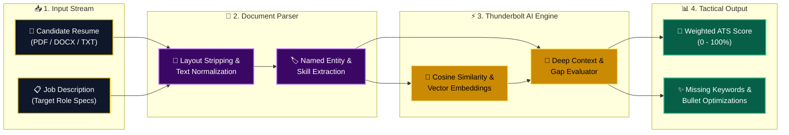
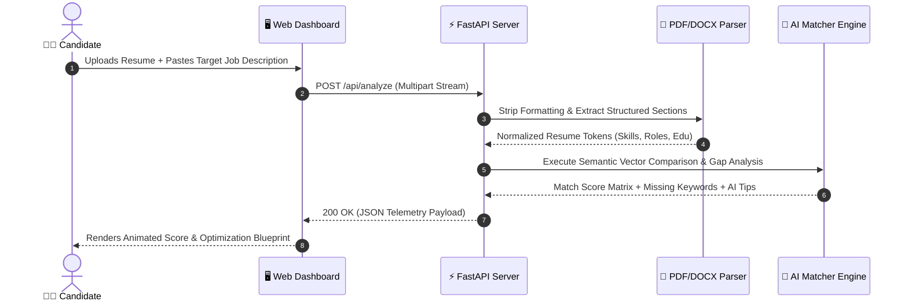
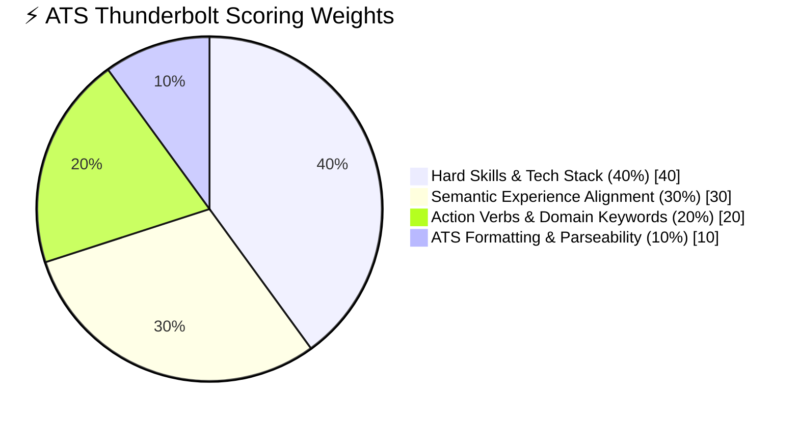

<div align="center">

<!-- ⚡ ANIMATED ELECTRIC WAVING HEADER (TWINKLING ANIMATION) ⚡ -->


<!-- ⚡ TRIPLE SYNCHRONIZED PIKACHU ATTACK SHOWCASE ⚡ -->
<table>
  <tr>
    <td align="center" width="33%">
      
      <br />
      <sub><b>⚡ STAGE 1:</b> Charging NLP Embeddings</sub>
    </td>
    <td align="center" width="34%">
      
      <br />
      <sub><b>💥 STAGE 2:</b> Crushing ATS Filters</sub>
    </td>
    <td align="center" width="33%">
      
      <br />
      <sub><b>🔥 STAGE 3:</b> 100% Match Overdrive</sub>
    </td>
  </tr>
</table>

<!-- ⚡ DUAL LIVE ANIMATED TYPING TERMINALS ⚡ -->
<a href="https://github.com/Adamnazeri/resumematcheraiproject">
  
</a>
<br />
<a href="https://github.com/Adamnazeri/resumematcheraiproject">
  
</a>

<br /><br />

<!-- ⚡ ANIMATED 3D SPRITES + LIVE REPO SHIELDS ⚡ -->

&nbsp;&nbsp;


&nbsp;&nbsp;


<br /><br />

<!-- MODERN SKILL ICONS SHOWCASE -->
<a href="https://skillicons.dev">
  
</a>

<br /><br />

<!-- INTERACTIVE NAVIGATION PILLS -->
<kbd> <a href="#-the-ats-boss-battle">⚡ Boss Battle</a> </kbd>
<kbd> <a href="#-live-thunderbolt-telemetry">📊 Live Telemetry</a> </kbd>
<kbd> <a href="#-high-voltage-ai-architecture">🏗️ AI Architecture</a> </kbd>
<kbd> <a href="#-ats-scoring-mathematics">🧮 Scoring Math</a> </kbd>
<kbd> <a href="#-quick-start--deployment">🚀 Quick Start</a> </kbd>
<kbd> <a href="#-api-payload-specs">📡 API Specs</a> </kbd>

</div>

<!-- ANIMATED ELECTRIC DIVIDER -->


## ⚡ The ATS Boss Battle

Over **75% of resumes** get eliminated by automated **Applicant Tracking Systems (ATS)** before a human recruiter ever reads them. **ResumeMatcher AI** acts as your electric battle companion—scanning the target Job Description and supercharging your resume to land a **Critical Hit**.

<table>
  <tr>
    <th width="48%">❌ Standard Unoptimized Resume (Low Voltage)</th>
    <th width="52%">⚡ Supercharged with ResumeMatcher AI (Thunderbolt Mode)</th>
  </tr>
  <tr>
    <td valign="top">
      <ul>
        <li>📉 <b>Blind Keyword Guessing:</b> Submitting generic resumes that fail automated boolean filters.</li>
        <li>🔍 <b>Context Mismatch:</b> Having strong engineering skills but phrasing them in ways parsers ignore.</li>
        <li>⏳ <b>Slow Manual Rewrites:</b> Spending 2+ hours editing bullet points for every job posting.</li>
        <li>📄 <b>Silent Formatting Errors:</b> Unknowingly using PDF layouts that scramble text extraction.</li>
      </ul>
    </td>
    <td valign="top">
      
      <ul>
        <li>🎯 <b>Precision Gap Detection:</b> Instantly spots every missing hard skill, framework, and keyword.</li>
        <li>🧠 <b>Semantic NLP Engine:</b> Measures deep contextual similarity between your experience and the JD.</li>
        <li>⚡ <b>Sub-Second AI Feedback:</b> Generates copy-ready rewrite suggestions and an exact match score.</li>
        <li>🛡️ <b>ATS Parser Verification:</b> Ensures 100% machine readability across PDF and DOCX formats.</li>
      </ul>
    </td>
  </tr>
</table>

<!-- ANIMATED ELECTRIC DIVIDER -->


## 📊 Live Thunderbolt Telemetry

Here is what a real-time **ResumeMatcher AI** evaluation looks like when matching a candidate against a **Full-Stack / AI Software Engineer** Job Description:

<table>
  <tr>
    <td width="46%" valign="top">
      <h3>🎯 ATS Combat Readiness Score</h3>
      
      <p><b>Target Role:</b> Full-Stack AI Engineer</p>
      <p><b>Overall Match:</b> <code>92% (SUPER EFFECTIVE!)</code></p>
      
      <br /><br />
      <b>⚡ Sub-System Telemetry:</b><br />
      🔹 <b>Hard Skills & Tech Stack:</b> <code>96%</code><br />
      <br />
      🔹 <b>Semantic Experience Alignment:</b> <code>89%</code><br />
      <br />
      🔹 <b>Domain Keywords & Action Verbs:</b> <code>85%</code><br />
      <br />
      🔹 <b>ATS Document Parseability:</b> <code>98%</code><br />
      
    </td>
    <td width="54%" valign="top">
      <h3>🧠 AI Skill Gap & Strike Report</h3>
      <p><b>✅ Detected High-Voltage Skills:</b></p>
      <p>
        <code>Python</code> <code>FastAPI</code> <code>React</code> <code>TypeScript</code> <code>Tailwind CSS</code> <code>Node.js</code> <code>Docker</code> <code>SQLite</code> <code>Git</code>
      </p>
      <p><b>⚠️ Missing Target Keywords (Inject to Reach 99%):</b></p>
      <p>
        <code>CI/CD Workflows</code> <code>PyTest</code> <code>Vector Databases</code> <code>Cloud Scaling</code>
      </p>
      <p><b>💡 AI Tactical Recommendation:</b></p>
      <blockquote>
        <i>"⚡ <b>Critical Insight:</b> Your core stack (<b>Python, FastAPI, React, Docker</b>) hits 96% of the technical requirements. Add one bullet point quantifying your API response times and mention automated testing (<b>PyTest / CI/CD</b>) to guarantee top-tier ATS ranking."</i>
      </blockquote>
    </td>
  </tr>
</table>

<!-- ANIMATED ELECTRIC DIVIDER -->


## 🏗️ High-Voltage AI Architecture

### 1. End-to-End Neural Processing Pipeline
GitHub automatically renders the color-coded architecture flowchart below:



### 2. Real-Time Execution Sequence



<!-- ANIMATED ELECTRIC DIVIDER -->


## 🧮 ATS Scoring Mathematics

**ResumeMatcher AI** computes a weighted multi-factor score across four recruitment dimensions:



| Scoring Dimension | Weight | Evaluation Criteria | Priority |
| :--- | :---: | :--- | :---: |
| **⚡ Hard Skills & Tech Stack** | `40%` | Exact and synonymous matches for languages, frameworks, databases, and tools. | 🔥 **Critical** |
| **🧠 Semantic Experience** | `30%` | Contextual alignment between past project deliverables and target role duties. | 🔥 **Critical** |
| **🔑 Keywords & Action Verbs** | `20%` | Industry terminology, measurable impact metrics, and leadership indicators. | ⚡ **High** |
| **📄 ATS Parseability** | `10%` | Clean section hierarchy, machine-readable text layers, and contact extraction. | 🛡️ **Essential** |

<!-- ANIMATED ELECTRIC DIVIDER -->


## 🚀 Quick Start & Deployment

> [!IMPORTANT]
> Ensure **Python 3.9+** and **Git** are installed on your system before launching the engine.

### 1️⃣ Clone the Repository
```bash
git clone [https://github.com/Adamnazeri/resumematcheraiproject.git](https://github.com/Adamnazeri/resumematcheraiproject.git)
cd resumematcheraiproject
```

### 2️⃣ Configure Environment Variables
Create a `.env` file in the project root directory:

<details open>
<summary><b>🔑 Click to view <code>.env</code> Configuration Template</b></summary>
<br />

```ini
# ==========================================
# ⚡ RESUMEMATCHER AI ENVIRONMENT CONFIG
# ==========================================
PORT=8000
ENV=development

# AI Model & API Configuration
AI_API_KEY=your_api_key_here
MODEL_NAME=gemini-2.5-flash

# Upload Limits
MAX_UPLOAD_SIZE_MB=10
ALLOWED_EXTENSIONS=pdf,docx,txt
```
</details>

### 3️⃣ Install Dependencies & Ignite Server

<details open>
<summary><b>🪟 Windows (PowerShell / CMD)</b></summary>
<br />

```bash
# Create and activate virtual environment
python -m venv venv
venv\Scripts\activate

# Install required packages
pip install -r requirements.txt

# Launch FastAPI server with hot-reload
uvicorn main:app --reload
```
</details>

<details>
<summary><b>🍎 macOS / 🐧 Linux</b></summary>
<br />

```bash
python3 -m venv venv
source venv/bin/activate
pip install -r requirements.txt
uvicorn main:app --reload
```
</details>

> [!TIP]
> Once the server is running, open **`http://127.0.0.1:8000`** for the web interface, or visit **`http://127.0.0.1:8000/docs`** to test the AI endpoints directly via **Interactive Swagger UI**!

<!-- ANIMATED ELECTRIC DIVIDER -->


## 📡 API Payload Specs

<details>
<summary><b>🧪 Click to Expand Sample JSON Response (<code>POST /api/analyze</code>)</b></summary>
<br />

```json
{
  "status": "success",
  "candidate": "Adam Nazeri",
  "target_role": "Full-Stack AI Engineer",
  "overall_match_score": 92,
  "verdict": "Super Effective Match",
  "breakdown": {
    "hard_skills": 96,
    "experience_alignment": 89,
    "keywords": 85,
    "ats_readability": 98
  },
  "matched_keywords": [
    "Python",
    "FastAPI",
    "React",
    "TypeScript",
    "Docker",
    "SQLite",
    "Git"
  ],
  "missing_keywords": [
    "CI/CD",
    "PyTest",
    "Vector DB"
  ],
  "recommendations": [
    "Add 'CI/CD' and 'PyTest' to your deployment and testing bullet points.",
    "Quantify backend API latency improvements to boost semantic impact score."
  ]
}
```
</details>

<details>
<summary><b>📂 Click to Expand Project Directory Structure</b></summary>
<br />

```text
resumematcheraiproject/
├── 📁 app / src/               # Core AI & backend modules
│   ├── 📄 parser.py            # PDF & DOCX text extraction pipeline
│   ├── 📄 matcher.py           # Semantic vector similarity & ATS scoring logic
│   └── 📄 schemas.py           # Pydantic data validation models
├── 📁 static / public/         # UI stylesheets, scripts & static assets
├── 📁 templates/               # Frontend HTML views
├── 📄 main.py / app.py         # FastAPI application entry point & routes
├── 📄 requirements.txt         # Python package dependencies
├── 📄 .env.example             # Environment variables template
└── 📄 README.md                # High-voltage documentation
```
</details>

<!-- ANIMATED ELECTRIC DIVIDER -->


<div align="center">

## 👨‍💻 Engineered By

<!-- PIKACHU FINISHER ANIMATION -->

<br />


### **Adam Nazeri**
*Software Developer | Full-Stack & AI Systems Builder*

[](https://github.com/Adamnazeri)
[](https://github.com/Adamnazeri/resumematcheraiproject)

<br />

**⚡ If this project electrifies your workflow, smash that ⭐ Star button on GitHub! ⚡**

<!-- ANIMATED ELECTRIC FOOTER WAVE -->


</div>
